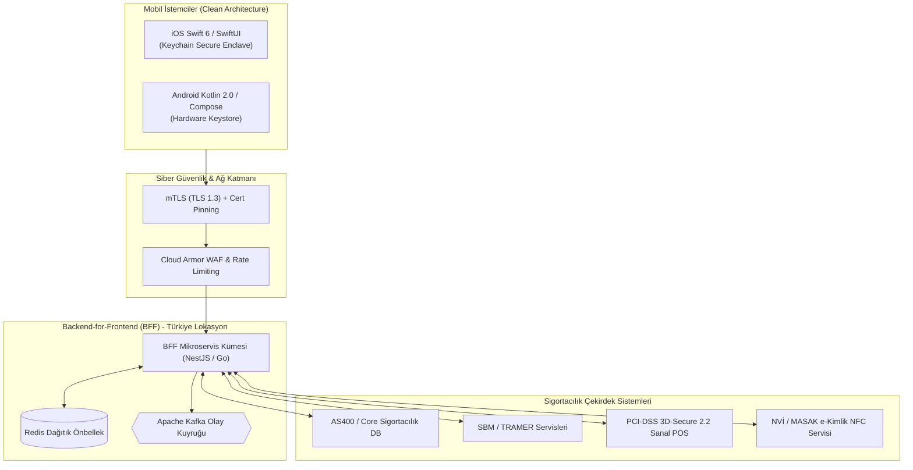

# AegisConnect | Kurumsal Sigorta Mobil Proje Sözleşme & SLA Paketi

[](LICENSE)
[](https://seddk.gov.tr)
[](https://mas.owasp.org)
[](#)
[](#)

Bu depo; bir sigorta şirketi (**Aegis Sigorta A.Ş.**) ile bir yazılım şirketi (**Nexora Bilişim A.Ş.**) arasında uçtan uca modern mobil sigortacılık uygulaması (**AegisConnect Mobile - iOS & Android**) yapımı üzerine akdedilen tüm yasal sözleşmeleri, teknik şartnameleri, SLA/SLO taahhütlerini ve **yazılım dünyasına yeni adım atmış acemi (junior) yazılım mühendisleri için hazırlanmış kapsamlı hayatta kalma kılavuzunu** hem **Türkçe** hem de **İngilizce** olarak içerir.

---

## 🏛️ Mimari ve Entegrasyon Şeması



---

## 📁 Dizin Yapısı ve İçindekiler

```
sigorta/
├── README.md                      # Proje ana tanıtımı ve dokümantasyon indeksi
├── web/                           # İnteraktif Sözleşme, SLA Hesaplayıcı ve Rehber Web Portalı
│   ├── index.html                 # Modern glassmorphism arayüz (TR & EN destekli)
│   ├── style.css                  # Fintech & InsurTech koyu tema tasarım sistemi
│   └── app.js                     # Çoklu dil ve dinamik SLA kesinti simülatörü
├── sozlesmeler-tr/                # Türkçe Resmi Kurumsal Sözleşmeler
│   ├── 01_ana_hizmet_sozlesmesi_msa.md       # Ana Hizmet Sözleşmesi (MSA)
│   ├── 02_is_emri_ve_teknik_sartname_sow.md   # İş Emri ve Teknik Şartname (SOW)
│   ├── 03_hizmet_seviyesi_taahhud_sla_slo.md  # SLA/SLO Taahhütleri ve Ceza Tablosu
│   ├── 04_gizlilik_ve_veri_koruma_kvkk_dpa.md # KVKK ve Sağlık Verileri DPA Sözleşmesi
│   ├── 05_bilgi_guvenligi_ve_seddk_uyum.md   # SEDDK, Bilgi Güvenliği ve Pentest Ek-4
│   └── 06_bakim_destek_ve_degisiklik_protokolu.md # Bakım, CR ve Adam/Gün Rayiç Protokolü
├── contracts-en/                   # English Legal & Technical Contract Suite
│   ├── 01_master_services_agreement_msa.md       # Master Services Agreement (MSA)
│   ├── 02_statement_of_work_technical_spec_sow.md # SOW & Technical Specifications
│   ├── 03_service_level_agreement_sla_slo.md     # Service Level Agreement (SLA & SLO)
│   ├── 04_data_protection_and_nda_gdpr_dpa.md   # DPA & Insurance Data Privacy (GDPR/KVKK)
│   ├── 05_information_security_and_regulatory_annex.md # InfoSec, DevSecOps & Audit Annex
│   └── 06_maintenance_support_and_change_protocol.md  # Maintenance & Change Request Protocol
└── rehber-junior-muhendis/        # Junior Yazılımcı Hayatta Kalma Kılavuzu (Madde Madde)
    ├── 00_giris_ve_sozluk.md                     # Hoş geldin! SLA, SOW, DoD, UAT nedir?
    ├── 01_sla_slo_ve_senin_uykun.md             # %99.9 Uptime, Crash-free ve P1 alarmları
    ├── 02_fikri_mulkiyet_acik_kaynak_tuzaklari.md # GPL lisansı riski ve kod mülkiyeti
    ├── 03_kabul_kriterleri_ve_scope_creep.md     # UAT kabulü ve "minicik buton" tuzakları
    ├── 04_kvkk_saglik_verisi_ve_loglama_felaketleri.md # console.log ile ceza alma rehberi
    ├── 05_guvenlik_pentest_ve_cezai_sartlar.md  # Beyaz şapkalı hackerlar kodunda ne arar?
    └── 06_junior_hayatta_kalma_kontrol_listesi.md# PR açmadan önce 10 altın kural
```

---

## ⚡ Hızlı Özet Tablosu

| Konu | Taahhüt / Hüküm | Junior Mühendise Notu |
| :--- | :--- | :--- |
| **Kullanılabilirlik (Uptime)** | **%99.90** (Ayda maks. 43 dk kesinti) | Circuit Breaker kur, sunucu düşerse mobil patlamasın. |
| **Mobil Çökmesiz Kullanıcı** | **Crash-Free Users ≥ %99.80** | Asla `!` veya `!!` force-unwrap yapma; safe-unwrapping kullan. |
| **P1 Kritik Arıza Yanıtı** | **15 Dk Yanıt / 4 Saat Kalıcı Yama** | Nöbetçiysen telefonun sesi açık olsun; aşımı saatlik 25.000 TL ceza! |
| **Fikri Mülkiyet (IP)** | Kodlar **münhasıran Müşteriye aittir**. | Şirket kodunu asla kişisel GitHub'ına atma (TCK 239 hapis riski). |
| **Açık Kaynak Lisansları** | Yalnızca **MIT, Apache 2.0, BSD**. | GPL/AGPL copyleft kütüphane eklersen tüm kodu dünyaya açmak gerekir! |
| **KVKK & Sağlık Sırrı** | Canlı veri yasağı, log maskeleme. | `console.log` ile TCKN veya reçete basarsan 9M TL KVKK cezası gelir. |
| **Siber Güvenlik (OWASP)** | OWASP MASVS L2, SSL Pinning. | Hassas veriyi SharedPreferences'a değil Keychain/Keystore'a yaz. |
| **Kapsam Yönetimi (CR)** | SOW dışı talepler ücretlidir (Man-Day).| Müşteri sohbette rica etti diye kodlama; resmi CR açtır. |

---

## 🌐 İnteraktif Web Portalını Yerel Olarak Çalıştırma

Projeyi tarayıcıda görsel olarak incelemek, SLA ceza simülatörünü çalıştırmak ve rehber bölümlerini okumak için:

```bash
# Python ile anında çalıştırma:
cd web && python3 -m http.server 8080

# veya Node.js npx ile:
npx serve web
```
Ardından tarayıcınızda `http://localhost:8080` adresine gidin.

---

## 📜 Lisans ve Telif

Bu şablon paketi eğitim ve kurumsal referans amaçlı hazırlanmış olup MIT Lisansı altındadır.
Gerçek ticari projelerinizde kullanmadan önce kurumunuzun hukuk müşavirliği ve siber güvenlik denetim birimlerince gözden geçirilmesi tavsiye edilir.
